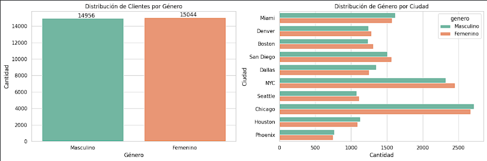
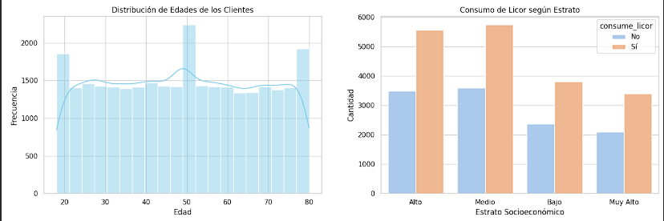
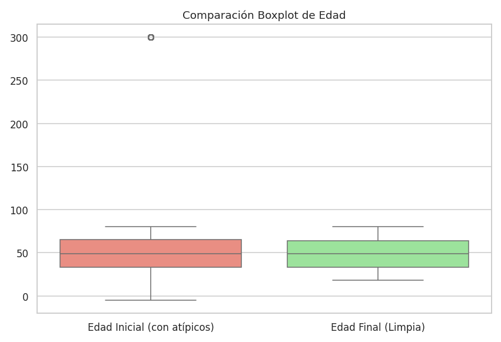
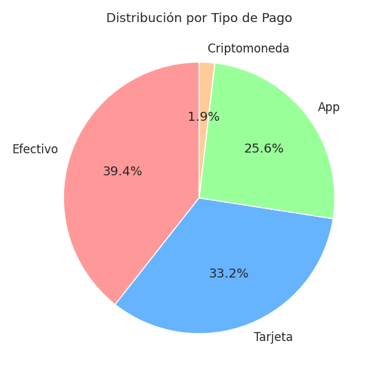

# Limpieza y Análisis Exploratorio de la Base de Datos de Restaurantes (USA)

**Universidad Cooperativa de Colombia – Pasto**
**Trabajo en equipo:** Andrés, Mora, Niko, Tefa y Camilo
**Herramientas:** Python, pandas, NumPy, Matplotlib, Seaborn, SciPy (Google Colab)

---

## Tabla de contenido

1. [Introducción y objetivo](#1-introducción-y-objetivo)
2. [Librerías y configuración](#2-librerías-y-configuración)
3. [Carga de la base de datos](#3-carga-de-la-base-de-datos)
4. [Limpieza de datos por integrante](#4-limpieza-de-datos-por-integrante)
   - [4.1 Andrés – Identificación](#41-andrés--identificación)
   - [4.2 Mora – Demográficos](#42-mora--demográficos)
   - [4.3 Niko – Consumo financiero](#43-niko--consumo-financiero)
   - [4.4 Tefa – Fidelización](#44-tefa--fidelización)
   - [4.5 Camilo – Contacto y pagos](#45-camilo--contacto-y-pagos)
5. [Ensamblaje final](#5-ensamblaje-final)
6. [Reconocimiento de los datos](#6-reconocimiento-de-los-datos)
7. [Exportación de la base limpia](#7-exportación-de-la-base-limpia)
8. [Estadísticos de comparación y gráficos](#8-estadísticos-de-comparación-y-gráficos)
9. [Resumen de decisiones de limpieza](#9-resumen-de-decisiones-de-limpieza)
10. [Conclusiones](#10-conclusiones)

---

## 1. Introducción y objetivo

El objetivo de este trabajo es **limpiar, estandarizar y explorar** una base de datos de clientes de restaurantes de Estados Unidos (`base_datos_restaurantes_USA_v2.csv`).

El trabajo se dividió en **cinco módulos**, uno por integrante, cada uno encargado de un grupo de variables:

| Integrante | Módulo | Variables |
|---|---|---|
| Andrés | Identificación | `id_persona`, `nombre`, `apellido`, `genero` |
| Mora | Demográficos | `edad`, `ciudad_residencia`, `estrato_socioeconomico` |
| Niko | Consumo financiero | `promedio_gasto_comida`, `frecuencia_visita`, `ocio` |
| Tefa | Fidelización | `preferencias_alimenticias`, `consume_licor`, `membresia_premium` |
| Camilo | Contacto y pagos | `telefono_contacto`, `correo_electronico`, `tipo_de_pago_mas_usado`, `ingresos_mensuales` |

Cada módulo se implementó como una **función independiente** que recibe el DataFrame, aplica las transformaciones y lo devuelve limpio. Al final, todas se ensamblan en un único flujo.

---

## 2. Librerías y configuración

Se importan las librerías para manipulación de datos (`pandas`, `numpy`), visualización (`matplotlib`, `seaborn`) y estadística (`scipy.stats`). Además, se define un tema visual de cuadrícula para todos los gráficos.

```python
import pandas as pd
import numpy as np
import matplotlib.pyplot as plt
import seaborn as sns
import scipy.stats as stats

sns.set_theme(style="whitegrid")
```

---

## 3. Carga de la base de datos

Se lee el archivo CSV y se crea una **copia de trabajo** (`df_limpio`) para conservar intacto el DataFrame original (`df`).

```python
# BASE DE DATOS
df = pd.read_csv('base_datos_restaurantes_USA_v2.csv')
df_limpio = df.copy()

print("Base de datos cargada. Filas y columnas originales:", df_limpio.shape)
```

---

## 4. Limpieza de datos por integrante

### 4.1 Andrés – Identificación

**Variables:** `id_persona`, `nombre`, `apellido`, `genero`

**Tarea:** como estas variables no tienen nulos, se realiza una limpieza de **consistencia** (estandarización de texto).

**Pasos:**
1. Eliminar espacios accidentales al inicio y al final (`str.strip()`).
2. Convertir nombres y apellidos a formato título (`str.title()`): `"JUAN PEREZ"` → `"Juan Perez"`.
3. Capitalizar el género (`str.capitalize()`): `"masculino"` → `"Masculino"`, evitando categorías duplicadas en los gráficos.

```python
def limpieza_andres(data):
    # Variables: id_persona, nombre, apellido, genero
    # Como no hay nulos, hacemos limpieza de consistencia (Estandarización de texto)

    # 1. Eliminar espacios en blanco accidentales al inicio o final de las palabras
    data['nombre'] = data['nombre'].str.strip()
    data['apellido'] = data['apellido'].str.strip()
    data['genero'] = data['genero'].str.strip()

    # 2. Formato Título: convierte "juan perez" o "JUAN PEREZ" a "Juan Perez"
    data['nombre'] = data['nombre'].str.title()
    data['apellido'] = data['apellido'].str.title()

    # 3. Capitalizar el género ("masculino" -> "Masculino") para evitar duplicados en los gráficos
    data['genero'] = data['genero'].str.capitalize()

    print("Andrés: Datos de identificación verificados y estandarizados.")
    return data
```

---

### 4.2 Mora – Demográficos

**Variables:** `edad`, `ciudad_residencia`, `estrato_socioeconomico`

**Tarea:** reemplazar los nulos de `edad` con la **mediana**.

**Pasos:**
1. **Valores imposibles:** edades menores a 18 o mayores a 100 (por ejemplo `-5` o `300`) se convierten en `NaN` para que no distorsionen la mediana.
2. **Imputación:** se calcula la mediana solo con datos válidos y se rellenan los nulos; luego se convierte la columna a entero.
3. **Estandarización categórica:** se eliminan espacios en `ciudad_residencia` y se aplica formato título a `estrato_socioeconomico`.

> **¿Por qué la mediana?** Es robusta frente a valores extremos, a diferencia de la media.

```python
def limpieza_mora(data):
    # Variables: edad, ciudad_residencia, estrato_socioeconomico
    # TAREA: Reemplazar nulos de 'edad' con la mediana o media

    # 1) Edades imposibles (-5, 300) -> NaN, para que no distorsionen la mediana
    data.loc[(data['edad'] < 18) | (data['edad'] > 100), 'edad'] = float('nan')

    # 2) Imputar nulos de 'edad' con la mediana (calculada solo con datos válidos)
    mediana_edad = data['edad'].median()
    data['edad'] = data['edad'].fillna(mediana_edad).astype(int)

    # 3) Estandarizar variables categóricas de ubicación y estrato
    data['ciudad_residencia'] = data['ciudad_residencia'].str.strip()
    data['estrato_socioeconomico'] = data['estrato_socioeconomico'].str.strip().str.title()

    print("Mora: Limpieza demográfica aplicada.")
    return data
```

---

### 4.3 Niko – Consumo financiero

**Variables:** `promedio_gasto_comida`, `frecuencia_visita`, `ocio`

**Pasos:**
1. **Nulos en `promedio_gasto_comida`:** se imputan con la mediana de la columna.
2. **Valores inconsistentes en `frecuencia_visita`:** se detectaron valores negativos (por ejemplo `-3`), que no tienen sentido para una frecuencia. Se reemplazan por la mediana de la frecuencia de visita.

```python
def limpieza_niko(data):
    # Variables: promedio_gasto_comida, frecuencia_visita, ocio

    # 1. Imputamos los valores nulos de 'promedio_gasto_comida' usando la mediana
    mediana_gasto = data['promedio_gasto_comida'].median()
    data['promedio_gasto_comida'] = data['promedio_gasto_comida'].fillna(mediana_gasto)

    # 2. Corregimos valores atípicos/inconsistentes en 'frecuencia_visita' (hay valores negativos de -3)
    # Reemplazamos los valores negativos por la mediana de la frecuencia de visita
    mediana_frecuencia = data['frecuencia_visita'].median()
    data.loc[data['frecuencia_visita'] < 0, 'frecuencia_visita'] = mediana_frecuencia

    print("Niko: Limpieza de consumo financiero aplicada (gasto imputado con mediana y frecuencias corregidas).")
    return data
```

---

### 4.4 Tefa – Fidelización

**Variables:** `preferencias_alimenticias`, `consume_licor`, `membresia_premium`

**Tarea:** reemplazar los nulos de estas variables categóricas con la **moda** (el valor más frecuente), ya que la mediana no aplica a datos cualitativos.

```python
def limpieza_tefa(data):
    # Variables: preferencias_alimenticias, consume_licor, membresia_premium
    # TAREA: Reemplazar nulos de 'preferencias_alimenticias' con la MODA (el valor más común)

    moda_preferencia = data['preferencias_alimenticias'].mode()[0]
    data['preferencias_alimenticias'] = data['preferencias_alimenticias'].fillna(moda_preferencia)

    moda_licor = data['consume_licor'].mode()[0]
    data['consume_licor'] = data['consume_licor'].fillna(moda_licor)

    moda_membresia = data['membresia_premium'].mode()[0]
    data['membresia_premium'] = data['membresia_premium'].fillna(moda_membresia)

    print("Tefa: Limpieza de preferencias aplicada.")
    return data
```

---

### 4.5 Camilo – Contacto y pagos

**Variables:** `telefono_contacto`, `correo_electronico`, `tipo_de_pago_mas_usado`, `ingresos_mensuales`

**Tarea:** unificar formatos y reemplazar nulos masivos con etiquetas descriptivas.

**Pasos:**
1. **Teléfono:** se unifica al formato `XXX-XXX-XXXX`:
   - se elimina la extensión (`x123`),
   - se conservan solo los dígitos,
   - se toman los últimos 10 dígitos (quita prefijos `+1`, `001`, `1`),
   - si no quedan 10 dígitos, el valor se descarta (queda nulo).
2. **Correo:** sin espacios y en minúsculas.
3. **Imputación masiva:** teléfonos nulos → `"Sin registro"`; correos nulos → `"No registrado"`.
4. **Tipo de pago:** estandarización de texto (sin nulos).
5. **Ingresos mensuales:** sin nulos, negativos ni ceros (rango 800 – 17 999); no requiere cambios.

```python
def limpieza_camilo(data):
    # Variables: telefono_contacto, correo_electronico, tipo_de_pago_mas_usado, ingresos_mensuales
    # TAREA: Reemplazar nulos masivos con "No registrado" / "Sin registro"

    # 1. Teléfono: unificar formato a XXX-XXX-XXXX
    #    Se quita la extensión (x123), el prefijo de país (+1, 001, 1) y todo lo que no sea dígito
    tel = data['telefono_contacto'].str.strip()
    tel = tel.str.replace(r'[xX].*$', '', regex=True)          # extensión
    tel = tel.str.replace(r'\D', '', regex=True)               # solo dígitos
    tel = tel.str[-10:]                                        # últimos 10 (quita +1 / 001)
    tel = tel.where(tel.str.len() == 10)                       # si no tiene 10 dígitos, se descarta
    tel = tel.str[:3] + '-' + tel.str[3:6] + '-' + tel.str[6:]
    data['telefono_contacto'] = tel

    # 2. Correo: sin espacios y en minúsculas
    data['correo_electronico'] = data['correo_electronico'].str.strip().str.lower()

    # 3. Imputación masiva de medios de contacto
    data['telefono_contacto'] = data['telefono_contacto'].fillna("Sin registro")
    data['correo_electronico'] = data['correo_electronico'].fillna("No registrado")

    # 4. Tipo de pago: consistencia de texto (no tiene nulos)
    data['tipo_de_pago_mas_usado'] = data['tipo_de_pago_mas_usado'].str.strip().str.capitalize()

    # 5. ingresos_mensuales: sin nulos, negativos ni ceros (rango 800 - 17999), no requiere cambios

    print("Camilo: Limpieza de contactos aplicada (formatos unificados y nulos imputados).")
    return data
```

---

## 5. Ensamblaje final

Se ejecutan las cinco funciones en secuencia sobre el mismo DataFrame y se verifica que **ya no queden valores nulos**.

```python
# ==========================================
# ENSAMBLAJE FINAL
# ==========================================
df_limpio = limpieza_andres(df_limpio)
df_limpio = limpieza_mora(df_limpio)
df_limpio = limpieza_niko(df_limpio)
df_limpio = limpieza_tefa(df_limpio)
df_limpio = limpieza_camilo(df_limpio)

# Verificamos que ya no queden nulos
print("\n--- REVISIÓN FINAL DE DATOS NULOS ---")
print(df_limpio.isnull().sum())
```

### Resultado obtenido

```text
Base de datos cargada. Filas y columnas originales: (30000, 17)
Andrés: Datos de identificación verificados y estandarizados.
Mora: Limpieza demográfica aplicada.
Niko: Limpieza de consumo financiero aplicada (gasto imputado con mediana y frecuencias corregidas).
Tefa: Limpieza de preferencias aplicada.
Camilo: Limpieza de contactos aplicada (formatos unificados y nulos imputados).

--- REVISIÓN FINAL DE DATOS NULOS ---
id_persona                   0
nombre                       0
apellido                     0
edad                         0
genero                       0
ciudad_residencia            0
estrato_socioeconomico       0
frecuencia_visita            0
promedio_gasto_comida        0
ocio                         0
consume_licor                0
preferencias_alimenticias    0
membresia_premium            0
telefono_contacto            0
correo_electronico           0
tipo_de_pago_mas_usado       0
ingresos_mensuales           0
dtype: int64
```

**Interpretación:** la base original tiene **30 000 registros y 17 variables**. Tras aplicar las cinco funciones de limpieza, **ninguna columna tiene valores nulos**, por lo que el proceso de imputación fue exitoso.

---

## 6. Reconocimiento de los datos

Una vez limpia la base, se hace un reconocimiento general:

- **Tipos de datos** de cada columna.
- **Estadísticos básicos cuantitativos:** conteo, media, desviación estándar, mínimo, cuartiles y máximo.
- **Estadísticos básicos cualitativos:** conteo, valores únicos, categoría más frecuente y su frecuencia.

```python
# ==========================================
# RECONOCIMIENTO DE DATOS
# ==========================================
print("\n--- TIPOS DE DATOS ---")
print(df_limpio.dtypes)

print("\n--- ESTADÍSTICOS BÁSICOS (Cuantitativas) ---")
print(df_limpio.describe())

print("\n--- ESTADÍSTICOS BÁSICOS (Cualitativas) ---")
print(df_limpio.describe(include=['object']))
```

### 6.1 Tipos de datos

| Variable | Tipo |
|---|---|
| `id_persona` | int64 |
| `nombre`, `apellido`, `genero` | object |
| `edad` | int64 |
| `ciudad_residencia`, `estrato_socioeconomico` | object |
| `frecuencia_visita` | int64 |
| `promedio_gasto_comida` | float64 |
| `ocio`, `consume_licor`, `preferencias_alimenticias`, `membresia_premium` | object |
| `telefono_contacto`, `correo_electronico`, `tipo_de_pago_mas_usado` | object |
| `ingresos_mensuales` | int64 |

### 6.2 Estadísticos de las variables cuantitativas

| Estadístico | `edad` | `frecuencia_visita` | `promedio_gasto_comida` | `ingresos_mensuales` |
|---|---|---|---|---|
| Conteo | 30 000 | 30 000 | 30 000 | 30 000 |
| Media | 48.92 | 4.26 | 32.57 | 5 389.76 |
| Desv. estándar | 18.07 | 2.22 | 26.34 | 4 538.49 |
| Mínimo | 18 | 0 | 0.00 | 800 |
| Q1 (25 %) | 33 | 3 | 13.33 | 1 860 |
| Mediana (50 %) | 49 | 4 | 25.51 | 3 402 |
| Q3 (75 %) | 64 | 5 | 44.28 | 7 761 |
| Máximo | 80 | 10 | 149.97 | 17 999 |

**Interpretación:**

- **Edad:** los clientes tienen entre 18 y 80 años, con media (48.9) y mediana (49) casi idénticas, lo que indica una distribución simétrica. Ya no aparecen edades imposibles como `-5` o `300`.
- **Frecuencia de visita:** va de 0 a 10 visitas, con mediana de 4. Ya no hay valores negativos.
- **Gasto promedio en comida:** la media (32.57) es mayor que la mediana (25.51), lo que indica una distribución **sesgada a la derecha**: la mayoría de clientes gasta poco y unos pocos gastan mucho (máximo 149.97).
- **Ingresos mensuales:** también sesgados a la derecha (media 5 389 frente a mediana 3 402), con alta variabilidad (desviación de 4 538).

### 6.3 Estadísticos de las variables cualitativas

| Variable | Categorías únicas | Más frecuente | Frecuencia | % del total |
|---|---|---|---|---|
| `nombre` | 690 | Michael | 678 | 2.3 % |
| `apellido` | 1 000 | Smith | 636 | 2.1 % |
| `genero` | 2 | Femenino | 15 044 | 50.1 % |
| `ciudad_residencia` | 10 | Chicago | 5 384 | 17.9 % |
| `estrato_socioeconomico` | 4 | Medio | 9 325 | 31.1 % |
| `ocio` | 2 | No | 15 094 | 50.3 % |
| `consume_licor` | 2 | Sí | 18 483 | 61.6 % |
| `preferencias_alimenticias` | 6 | Carnes | 9 319 | 31.1 % |
| `membresia_premium` | 2 | No | 17 155 | 57.2 % |
| `telefono_contacto` | 14 835 | Sin registro | 15 166 | 50.6 % |
| `correo_electronico` | 14 475 | No registrado | 15 072 | 50.2 % |
| `tipo_de_pago_mas_usado` | 4 | Efectivo | 11 813 | 39.4 % |

**Interpretación:**

- Cerca de la **mitad de los clientes no tiene teléfono (50.6 %) ni correo (50.2 %) registrado**. Esto limita cualquier estrategia de contacto o fidelización directa.
- Un **61.6 %** de los clientes consume licor y solo el **42.8 %** tiene membresía premium.
- El método de pago más usado es el **efectivo** (39.4 %), y la preferencia alimenticia más común son las **carnes** (31.1 %).

---

## 7. Exportación de la base limpia

El DataFrame limpio se guarda como un nuevo archivo CSV (`base_datos_restaurantes_LIMPIA.csv`).

```python
# Guardar el DataFrame limpio en un nuevo archivo CSV dentro de Colab
df_limpio.to_csv('base_datos_restaurantes_LIMPIA.csv', index=False)
```

---

## 8. Estadísticos de comparación y gráficos

Se construye un panel de **cuatro gráficos** (cuadrícula de 2 × 2) para describir visualmente a los clientes.

```python
# Configurar el tamaño general de los gráficos
plt.figure(figsize=(15, 10))
```

### 8.1 Distribución de clientes por género

**Tipo:** gráfico de barras (conteo) individual, con etiquetas de datos sobre cada barra.
**Objetivo:** conocer cuántos clientes hay por cada género.

```python
plt.subplot(2, 2, 1)
ax1 = sns.countplot(data=df_limpio, x='genero', palette='Set2')
plt.title('Distribución de Clientes por Género')
plt.ylabel('Cantidad')
plt.xlabel('Género')
for p in ax1.patches: # Agregar las etiquetas de datos
    ax1.annotate(f'{int(p.get_height())}', (p.get_x() + 0.35, p.get_height() + 100))
```

### 8.2 Distribución de género por ciudad

**Tipo:** gráfico de barras agrupado (horizontal).
**Objetivo:** comparar la composición por género en cada ciudad de residencia.

```python
plt.subplot(2, 2, 2)
sns.countplot(data=df_limpio, y='ciudad_residencia', hue='genero', palette='Set2')
plt.title('Distribución de Género por Ciudad')
plt.ylabel('Ciudad')
plt.xlabel('Cantidad')
```

### 8.3 Histograma de edades

**Tipo:** histograma con curva de densidad (KDE) y 20 intervalos.
**Objetivo:** observar la forma de la distribución de la edad de los clientes (variable cuantitativa).

```python
plt.subplot(2, 2, 3)
sns.histplot(data=df_limpio, x='edad', bins=20, kde=True, color='skyblue')
plt.title('Distribución de Edades de los Clientes')
plt.xlabel('Edad')
plt.ylabel('Frecuencia')
```

### 8.4 Consumo de licor según estrato

**Tipo:** gráfico de barras agrupado.
**Objetivo:** analizar si el consumo de licor varía entre estratos socioeconómicos.

```python
plt.subplot(2, 2, 4)
sns.countplot(data=df_limpio, x='estrato_socioeconomico', hue='consume_licor', palette='pastel')
plt.title('Consumo de Licor según Estrato')
plt.xlabel('Estrato Socioeconómico')
plt.ylabel('Cantidad')
```

### 8.5 Mostrar el panel

```python
plt.tight_layout()
plt.show()
```

### 8.6 Resultados e interpretación




**Género (gráfico 1):** la base está prácticamente **balanceada**: 14 956 clientes masculinos frente a 15 044 femeninos (49.9 % y 50.1 %).

**Género por ciudad (gráfico 2):**

- **Chicago** y **NYC** son las ciudades con más clientes; **Phoenix** es la que tiene menos.
- En todas las ciudades las diferencias entre géneros son pequeñas (la mayor es de 127 clientes, en NYC).
- Predominan los **hombres** en Dallas, Chicago, Miami, Houston y Phoenix, y las **mujeres** en NYC, Boston, San Diego, Denver y Seattle.



**Edades (gráfico 3):**

- La distribución es **aproximadamente uniforme** entre los 18 y los 80 años, con alrededor de 1 400 a 1 500 clientes por intervalo.
- Hay tres picos: en los extremos (≈ 18 y ≈ 80 años) y cerca de los **50 años**. Al revisar los datos, la explicación es la siguiente:
  - **Efecto del histograma (los tres picos):** las edades son números enteros y el histograma usa 20 intervalos de 3.1 años de ancho. Por eso 17 intervalos contienen 3 edades distintas y 3 intervalos (el primero, el que empieza en 49 y el último) contienen **4**, y esos son justo los que se ven más altos. No es un comportamiento real de los clientes.
  - **Efecto de la imputación (pico central):** se imputaron **308 edades** con la mediana (207 imposibles y 101 nulas), por lo que la edad **49** aparece 812 veces, frente a unas 470 de sus edades vecinas. Eso refuerza el pico del centro.

> **Cómo evitar el efecto del histograma:** usar un intervalo por edad con `sns.histplot(data=df_limpio, x='edad', discrete=True, kde=True)`. Así se ve una distribución plana con un único pico real en la edad 49.

**Consumo de licor según estrato (gráfico 4):**

- En **todos los estratos** hay más clientes que consumen licor que clientes que no.
- Los estratos **Medio** y **Alto** tienen las barras más altas simplemente porque tienen más clientes.
- Al comparar proporciones, el porcentaje de consumidores es prácticamente el mismo en todos los estratos: **Alto 61.5 %, Medio 61.5 %, Bajo 61.7 % y Muy Alto 61.8 %**. El estrato **no parece influir** en el consumo de licor.

> **Nota técnica:** Colab muestra una advertencia `FutureWarning` por usar `palette` sin `hue` en `sns.countplot`. No afecta el resultado. Para evitarla, se puede escribir `sns.countplot(data=df_limpio, x='genero', hue='genero', palette='Set2', legend=False)`.

### 8.7 Boxplot comparativo y diagrama de torta

Se crea una segunda figura de 2 × 2 en la que solo se usan dos posiciones: el **boxplot** de edad (arriba a la derecha) y el **diagrama de torta** de tipo de pago (abajo a la izquierda). Los otros dos espacios se ocultan con `axis('off')`.

```python
# ==========================================
#  PUNTO 3.1: BOXPLOT COMPARATIVO Y DIAGRAMA DE TORTA
# ==========================================
fig, axes = plt.subplots(2, 2, figsize=(15, 10))

# 2. Boxplot Comparativo (Cuantitativa: Edad Inicial vs Limpia)
# Se usa un DataFrame con dos columnas de nombres distintos para que seaborn dibuje dos cajas
edad_comparacion = pd.DataFrame({
    'Edad Inicial (con atípicos)': df['edad'],
    'Edad Final (Limpia)': df_limpio['edad']
})
sns.boxplot(
    data=edad_comparacion,
    ax=axes[0, 1],
    palette=['salmon', 'lightgreen']
)
axes[0, 1].set_title("Comparación Boxplot de Edad")

# 3. Diagrama de Torta (Cualitativa: Tipo de Pago)
df_limpio['tipo_de_pago_mas_usado'].value_counts().plot(
    kind='pie', ax=axes[1, 0], autopct='%1.1f%%', startangle=90,
    colors=['#ff9999','#66b3ff','#99ff99','#ffcc99']
)
axes[1, 0].set_title("Distribución por Tipo de Pago")
axes[1, 0].set_ylabel("")

# Ocultar subplots vacíos
axes[0, 0].axis('off')
axes[1, 1].axis('off')

plt.tight_layout()
plt.show()
```

> **Nota:** las dos series de edad se agrupan en un DataFrame con nombres de columna distintos. Si se pasa una lista de dos series que se llaman igual (`'edad'`), seaborn las trata como una sola y dibuja **una única caja** en lugar de dos.

#### 8.7.1 Boxplot comparativo de edad

- **Tipo:** diagrama de caja y bigotes, con dos cajas lado a lado.
- **Objetivo:** mostrar el efecto de la limpieza sobre la variable `edad`.
- **Cómo se construye:** la primera caja usa la edad **original** (`df['edad']`) y la segunda la edad **limpia** (`df_limpio['edad']`). Como `df_limpio` es una copia, `df` conserva los datos originales.



**Interpretación:**

- **Edad inicial:** la base original tenía **207 edades imposibles**: 97 registros con `-5` y 110 con `300`. El `300` aparece como punto atípico en la parte superior del gráfico y el `-5` extiende el bigote inferior por debajo de cero. Por culpa de estos valores la escala llega hasta 300 y la caja se ve aplastada.
- **Edad final (limpia):** los valores imposibles desaparecen y las edades quedan entre **18 y 80 años**. Los datos ya no tienen atípicos.
- **Cuartiles:** la limpieza casi no cambia la forma central de la distribución. La mediana es 49 en ambas cajas, Q1 = 33 en ambas y Q3 pasa de 65 a 64.
- Además, la edad original tenía **101 valores nulos** que se imputaron con la mediana (49).

#### 8.7.2 Diagrama de torta: tipo de pago

- **Tipo:** diagrama circular con porcentajes (`autopct`).
- **Objetivo:** mostrar qué proporción de clientes usa cada medio de pago (variable cualitativa).



| Tipo de pago | Clientes | Porcentaje |
|---|---|---|
| Efectivo | 11 813 | 39.4 % |
| Tarjeta | 9 954 | 33.2 % |
| App | 7 678 | 25.6 % |
| Criptomoneda | 555 | 1.85 % |

**Interpretación:**

- El **efectivo** sigue siendo el medio de pago más usado (39.4 %), seguido de la **tarjeta** (33.2 %).
- Entre efectivo y tarjeta suman el **72.6 %** de los clientes, y el pago por **app** ya alcanza una cuarta parte (25.6 %).
- Las **criptomonedas** son marginales (1.85 %, 555 clientes).

---

## 9. Resumen de decisiones de limpieza

| Variable | Problema detectado | Solución aplicada | Responsable |
|---|---|---|---|
| `nombre`, `apellido` | Espacios y mayúsculas inconsistentes | `strip()` + `title()` | Andrés |
| `genero` | Diferencias de mayúsculas/minúsculas | `strip()` + `capitalize()` | Andrés |
| `edad` | Valores imposibles (< 18 o > 100) y nulos | Convertir a `NaN` e imputar con la **mediana** | Mora |
| `ciudad_residencia`, `estrato_socioeconomico` | Espacios y formato inconsistente | `strip()` (+ `title()` en estrato) | Mora |
| `promedio_gasto_comida` | Valores nulos | Imputar con la **mediana** | Niko |
| `frecuencia_visita` | Valores negativos | Reemplazar por la **mediana** | Niko |
| `preferencias_alimenticias`, `consume_licor`, `membresia_premium` | Valores nulos | Imputar con la **moda** | Tefa |
| `telefono_contacto` | Formatos mezclados (extensiones, prefijos de país) | Normalizar a `XXX-XXX-XXXX`; nulos → `"Sin registro"` | Camilo |
| `correo_electronico` | Espacios, mayúsculas y nulos | `strip()` + `lower()`; nulos → `"No registrado"` | Camilo |
| `tipo_de_pago_mas_usado` | Formato de texto inconsistente | `strip()` + `capitalize()` | Camilo |
| `ingresos_mensuales` | Sin problemas (rango 800 – 17 999) | Sin cambios | Camilo |

### 9.1 Registros corregidos en la limpieza

| Variable | Registros afectados | % de 30 000 | Valor de reemplazo |
|---|---|---|---|
| `edad` | 308 (207 imposibles: 97 con `-5` y 110 con `300`; 101 nulos) | 1.0 % | Mediana = 49 |
| `promedio_gasto_comida` | 145 nulos | 0.5 % | Mediana = 25.51 |
| `frecuencia_visita` | 1 547 negativos (todos con valor `-3`) | 5.2 % | Mediana = 4 |
| `preferencias_alimenticias` | 1 403 nulos | 4.7 % | Moda = Carnes |
| `telefono_contacto` | 15 166 nulos | 50.6 % | `"Sin registro"` |
| `correo_electronico` | 15 072 nulos | 50.2 % | `"No registrado"` |

---

## 10. Conclusiones

1. **Calidad de datos:** la base de 30 000 registros y 17 variables quedó **sin valores nulos** y con formatos consistentes (texto estandarizado, teléfonos en `XXX-XXX-XXXX`, edades y frecuencias dentro de rangos válidos).
2. **Perfil de los clientes:** hay equilibrio de género (≈ 50 % y 50 %), las edades van de 18 a 80 años con una distribución casi uniforme, y la mayor concentración está en Chicago y NYC.
3. **Consumo:** el gasto en comida y los ingresos tienen distribuciones sesgadas a la derecha; el efectivo es el medio de pago más usado (39.4 %), seguido de tarjeta (33.2 %) y app (25.6 %), y el 61.6 % de los clientes consume licor, con una proporción casi idéntica en todos los estratos (61.5 % a 61.8 %).
4. **Limitación principal:** aproximadamente la mitad de los clientes no tiene teléfono ni correo registrado, y solo el 42.8 % tiene membresía premium. Esto indica oportunidades de mejora en la captura de datos de contacto y en la fidelización.
5. **Aspectos a revisar:**
   - La imputación de 308 edades con la mediana refuerza el pico en la edad 49 (812 clientes, frente a unos 470 en las edades vecinas). El resto de los picos del histograma se debe al ancho de los intervalos.
   - **1 463 clientes (4.9 %) tienen un gasto promedio de 0** en la base original. No son nulos imputados, así que conviene validar con quien administra la base si son datos reales.
   - La imputación con la moda infló la preferencia **Carnes**: sin imputar tenía 7 916 clientes (27.7 % de los registros con dato) y tras imputar 1 403 nulos pasó a 9 319 (31.1 %).

---

*Fin del documento.*
